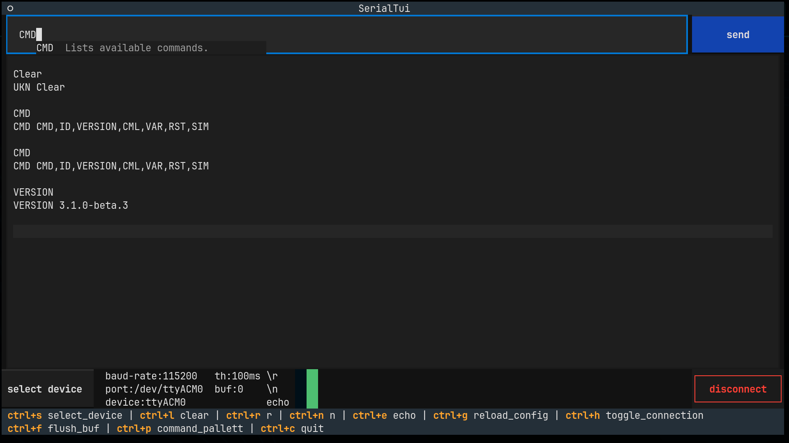
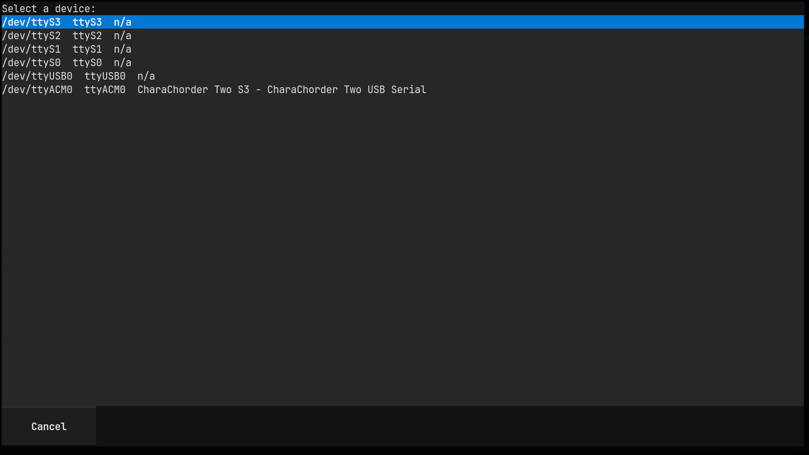
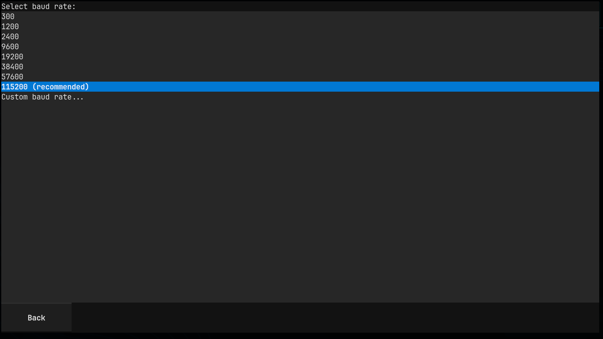
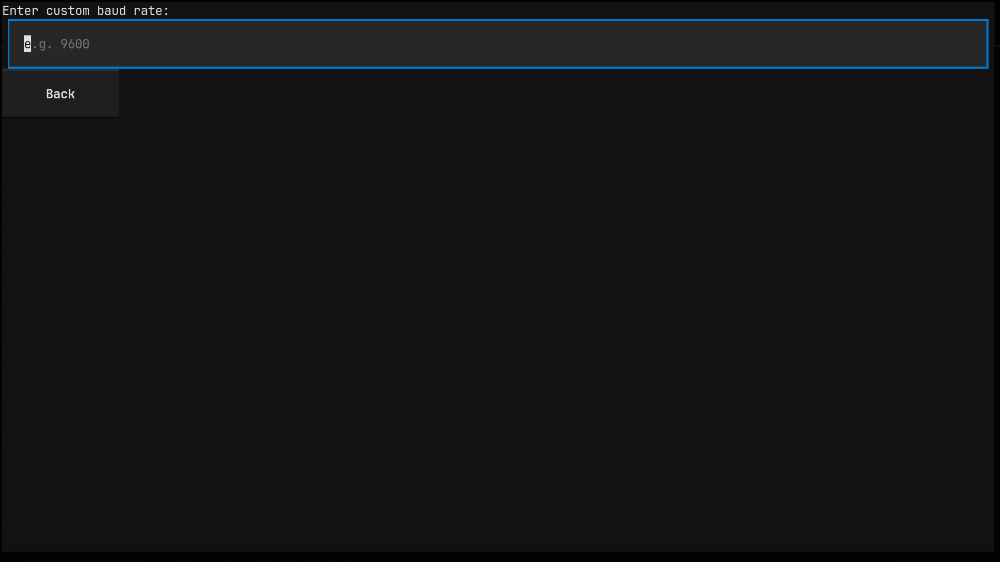
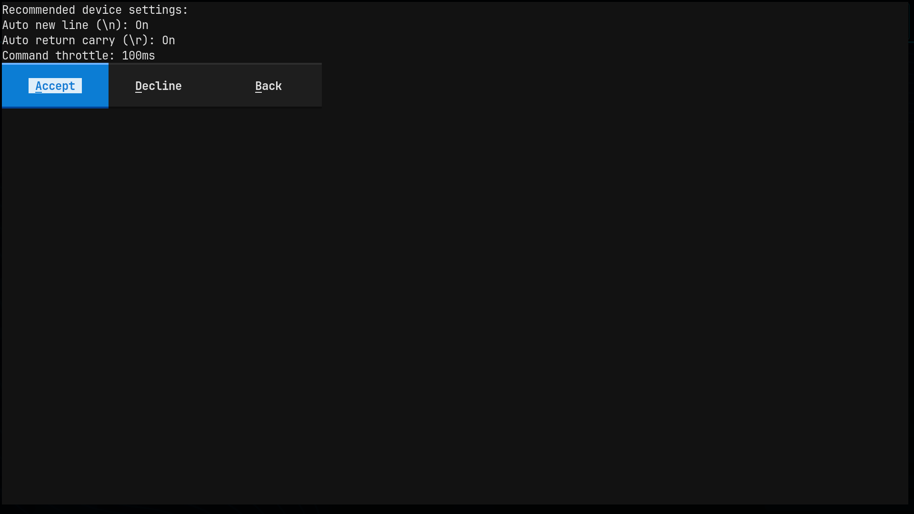

# Serial TUI

Serial TUI is a much more modern take on serial terminal's and communicating with devices over them. Serial TUI is sleek looking(at least for a TUI) simple to use and support many features which are uncommon to find in serial terminals such as autocomplete or throttling.

## About
A modern serial terminal that makes communicating with hardware easier. Featuring device-specific autocomplete, command throttling, and customizable-feeling keyboard-driven workflows.

It supports a keybinding for each of its features and lets you avoid using `!command` to access almost all of its functionality, allowing you to recreate a REPL-like experience inside the TUI if you wish.

There is also mouse support for all major functionality (in case, unlike me, you don't use Vim, BTW).

## Install

Install the CLI with [uv](https://docs.astral.sh/uv/):

```sh
uv tool install git+https://github.com/Ben-Collett/serial_tui
serial-tui
```

For local development, run `uv sync` then `uv run serial-tui` (or
`uv run python -m serial_tui`).

## UI

### Main screen

The UI consists of several screens. The main screen has a header with a button that brings up the command palette and displays the program name.

Under that header are the input field and send button. The input field allows you to type data to send, or — if you start your message with `!` — to run a Serial TUI command; these are discussed in a later section. If you want to send a literal `!` at the start of a message, type `!!`.
The input field supports autocomplete for commands and any known devices. The only currently known default device is the CharaChorder, but you can add your own if needed, as described in the configuration section.

The output area is underneath that. It lets you read any data sent from the connected serial device, as well as the output of some Serial TUI commands.
In the configuration for the program, you can define how the output section should handle vertical auto-scrolling.

The section underneath that has a button to select a device, a column that declares some information about the current connection, a column for the throttle rate and the number of buffered messages, and a column allowing you to toggle auto-appending `\r\n` and echoing whatever data you send back in the output section. There is also a connect/disconnect button.

Underneath that section is a footer that displays the available keybindings; if they do not all fit, it ends with `...`.



### Select device screen

The select device screen has a header that simply says `Select a device:`.
Underneath that is a section that can be navigated using Vim-based motions:

| Key | Action |
| --- | --- |
| `j` | Move down |
| `k` | Move up |
| `g` | Jump to the top |
| `G` | Jump to the bottom |

It displays each serial device's path, name, and description, or `n/a` if there is none.

You can press the cancel button at the bottom or hit `esc` to cancel.
Once you select the device, you go to the select baud rate screen.



### Select baud rate

Select baud rate is the same as the select device screen, except it is for the rate. By default, 9600 is highlighted, but if there is a recommended setting for a known device, that may be focused instead, with `(recommended)` next to it.
Once again, there is a back button, or you can press `esc` to go back.



There is one option at the end of the list that brings you to a screen to enter a custom baud rate.
Once again, there is a back button, or you can press `esc` to go back.



Once selected, one final screen may appear if your device is a known device; it may ask whether you want to apply the recommended settings for newlines and throttle wait.



## Configuration

Serial TUI uses a TOML-based configuration for the main functionality and a JSONL-based configuration for device-specific configuration, such as autocomplete.
See the [example_config](example_config/config.toml) directory for a fully documented example configuration. Essentially, each line is an autocomplete suggestion; the line should have an `n` key for the autocomplete name and a `d` key for its description.

Depending on your operating system, the config files will be located in one of the following directories:

| Operating system | Config directory |
| --- | --- |
| Linux | `$XDG_CONFIG_HOME/serial_tui` (or `~/.config/serial_tui` if unset) |
| macOS | `~/Library/Application Support/serial_tui` |
| Windows | `%APPDATA%\serial_tui` |

### Appearance

Serial TUI allows you to change your current theme in the command palette.
There is a host of default themes you can use provided by Textual.
If you want to change the default theme, `textual-dark`, you can do so by using the `theme` key in the `[ui]` section of your `config.toml`:

```toml
[ui]
theme = "tokyo-night"
```

You can define a theme directory and set your theme to that if you wish:

```toml
theme = "full_documented_theme"
```

You can define whether you want the header to be visible or not; the default is `true`:

```toml
header_visible = true
```

The maximum height of the footer; set it to zero to hide it. This is a maximum, so there can be fewer rows if there are not enough keybindings to justify it:

```toml
footer_max_height = 2
```

And whether or not you want to shorten keybindings (`ctrl+` gets replaced with `^` in the footer):

```toml
shorten_bindings = false
```

You can also define the auto-scroll behaviour for the output section:
`never` | `always` | `bottom`

| Value | Behaviour |
| --- | --- |
| `never` | Never auto-scrolls |
| `always` | Always auto-scrolls to the bottom |
| `bottom` | Only auto-scrolls to the bottom when adding new text to the output if you were already at the bottom. This is the default behaviour |

```toml
auto_scroll = "bottom"
```

You can configure how long the auto-scroll animation lasts; 0.4 seconds is pretty good. The default is zero, and anything zero or less disables the animation:

```toml
auto_scroll_duration_s = 0
```

### Commands

Commands are typed into the input field with a leading `!` (for example, `!clear`). The built-in commands, along with their aliases, are:

| Command | Aliases | Description |
| --- | --- | --- |
| `r` | | Toggle `\r` newline |
| `n` | | Toggle `\n` newline |
| `rl` | `reload`, `reload_config` | Reload the config |
| `rn` | | Toggle both `\r` and `\n` |
| `ren` | | Toggle `\r`, `\n`, and echo |
| `q` | `quit` | Terminate the program |
| `e` | `echo` | Toggle local echo |
| `p` | `pallett`, `command_pallett` | Show the command palette |
| `toggle_connection` | `c` | Toggle the device connection |
| `con` | `connect` | Connect to the device (disconnects and reconnects if already connected) |
| `dis` | `disconnect` | Disconnect from the device |
| `s` | `select`, `select_device` | Open device selection |
| `clear` | `l` | Clear the output terminal |
| `th` | `throttle` | Set or view the throttle in milliseconds (for example, `!th 100`) |
| `flush` | `fl`, `flush_buf` | Flush buffered commands |
| `cmds` | | Print all available commands to the output section |
| `keys` | | Print all keybindings to the output section |
| `device_info` | | Print the selected device's info to the output section |
| `send` | | Send data to the device |

These are the defaults and can be overridden in the `[commands]` section of `config.toml`. You can define your own commands there too, map a single name to several commands with a list(`ren = ["rn", "echo"]`), provide descriptions in `[command_descriptions]`, and bind commands to keys in `[keybindings]`. See the [example config](example_config/config.toml) for details.

### Keybindings

If you have a `[keybindings]` section in your `config.toml`, all default keybindings are overwritten.
You can set up any keybinding you wish using the syntax below; these are also the default keybindings (note that you need to put the key in quotes in TOML if it uses a `+`):

```toml
[keybindings]
"ctrl+s"= "select_device",
"ctrl+l"= "clear",
"ctrl+r"= "r",
"ctrl+n"= "n",
"ctrl+e"= "echo",
"ctrl+g"= "reload_config",
"ctrl+h"= "toggle_connection",
"ctrl+f"= "flush_buf",
"ctrl+p"= "command_pallett",
"ctrl+c"= "quit",
```

### Per-serial-device configuration

To configure a custom serial device, you need to define a JSONL file that defines the autocomplete suggestions in your config directory at `devices/<device_name>.jsonl`.
`n` is the command name and `d` its description; see [charachorder.jsonl](example_config/devices/charachorder.jsonl) for an example of how this is done.
Once you have the device autocomplete set up, you need to link it in `config.toml`.
Again, you can see this in the [example config](example_config/config.toml), but it looks something like this:
the `name` is the name of the device, and `[[devices]]` stores the device in an array of devices so you can have multiple.
The name must match the `.jsonl` file's basename without its extension.
`description_pattern` matches against a description; in the case of `(?i)charachorder`, we are doing a case-insensitive search for the CharaChorder.
The other options are fairly obvious: `throttle_ms` lets you change the suggested throttle rate, `auto_n` and `auto_r` suggest whether to append `\r\n` to each message, and `baud_rate` is the default recommended baud rate for the device.

```toml
[[devices]]
name = "charachorder"
description_pattern = "(?i)charachorder"
throttle_ms = 100
auto_n = true
auto_r = true
baud_rate = 115200
```

## License

BSD Zero Clause License — see [LICENSE](LICENSE).
